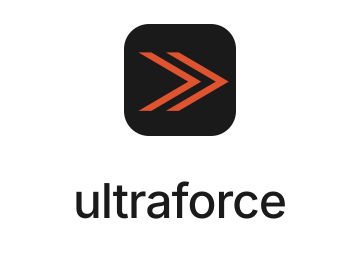

<p align="center">
  
</p>

<p align="center">
  <b>A fast, local-first Salesforce developer desktop toolkit.</b><br>
  Run SOQL, execute anonymous Apex, and read debug logs — with offline,
  IntelliSense-grade code completion for both SOQL and Apex.
</p>

<p align="center">
  <a href="https://github.com/dormonbear/ultraforce-desktop/releases/latest"></a>
  <a href="https://github.com/dormonbear/ultraforce-desktop/releases"></a>
  
  <a href="./LICENSE"></a>
  <a href="https://github.com/dormonbear/ultraforce-desktop/actions/workflows/release.yml"></a>
</p>

<p align="center">
  <a href="#install"><b>Download</b></a> ·
  <a href="#features">Features</a> ·
  <a href="#how-it-works">How it works</a> ·
  <a href="#development">Development</a>
</p>

> **Status:** personal developer tool, actively developed. APIs and UI may change.

## Why Ultraforce

- **No analytics or usage tracking.** Workspaces and functional caches stay on
  your computer. Salesforce tools contact your org; update checks contact GitHub.
  See [Privacy](PRIVACY.md) for local storage, network access and legacy files.
- ⚡ **Local-first & fast.** A native Tauri 2 + Rust desktop app that drives the
  official Salesforce CLI (`sf`) under the hood — it works against any org you
  are already authenticated to, with no extra login.
- 🧠 **Offline IntelliSense.** Context-aware completion for SOQL *and* Apex,
  sourced only from first-party Salesforce endpoints (Tooling API / object
  describes). Index an org once, then complete 100% offline.
- 🔍 **Three core tasks, one window.** SOQL, anonymous Apex, and debug logs —
  the everyday Salesforce-dev loop without a browser tab in sight.

## Install

Download the latest build for your OS from the
[**Releases page**](https://github.com/dormonbear/ultraforce-desktop/releases/latest):

| OS | Download |
| --- | --- |
| **macOS** (Apple Silicon) | `Ultraforce_<ver>_aarch64.dmg` |
| **macOS** (Intel) | `Ultraforce_<ver>_x64.dmg` |
| **Windows** | `Ultraforce_<ver>_x64-setup.exe` or `_x64_en-US.msi` |
| **Linux** | `.AppImage`, `.deb`, or `.rpm` |

The app drives the Salesforce CLI, so install and authenticate
[`sf`](https://developer.salesforce.com/tools/salesforcecli) first
(`sf org login web`).

<details>
<summary><b>First-launch bypass</b> (builds are not paid-code-signed)</summary>

- **macOS** — if you see *"… is damaged and can't be opened"*, clear the download
  quarantine flag, then open normally:
  ```bash
  xattr -cr /Applications/Ultraforce.app
  ```
  On builds that show the milder "unidentified developer" prompt, just
  right-click the app → **Open** → **Open**.
- **Windows** — on the SmartScreen prompt, click **More info → Run anyway**.

</details>

Updates are delivered in-app: Ultraforce checks the Releases page on launch and
offers a one-click download-and-restart when a newer version is available.

## Features

- **SOQL panel** — Monaco editor with context-aware completion (fields, objects,
  relationships, SOQL functions, clause keywords), unknown-field diagnostics from
  live object describes, `TABLE` / `TREE` result views, and an `EXPLAIN` query plan.
- **Anonymous Apex panel** — run anonymous Apex with per-category debug-level
  pickers (a generated `TraceFlag` / `DebugLevel`), jump-to-line compile errors,
  and a colorized debug-log viewer with one-click copy. An optional
  confirm-before-run guard (Settings → Apex) protects against executing DML in
  the wrong org.
- **Apex completion** — member completion over an offline symbol table (OST):
  stdlib namespaces, every org Apex class (full symbol tables), and sObjects
  (fields + relationships) described on demand. Expression-chain inference,
  generic-collection element unwrap, and inheritance/interface flattening.
  Methods insert call snippets with placeholder arguments (and a trailing `;`
  for void statements), pop **signature help** as you fill them in, plus
  constructor completion after `new`, control-flow keyword blocks, and
  bracket / quote auto-closing.
- **Logs panel** — master/detail debug-log viewer with status badges, governor
  limits, and tree / limits / raw tabs, plus a clear hint when the org user
  lacks the permission to read `ApexLog`.
- **Explorer + workspace** — VS Code-style sidebar over real `*.soql` / `*.apex`
  files on disk with keyboard navigation, drag-to-move, and inline rename;
  multi-tab editing with debounced autosave, name and full-text search with
  jump-to-line, and run history.

## How it works

Ultraforce keeps an **offline symbol table (OST)** per org. Index an org once and
completion is served entirely from local data — no per-keystroke network calls.
Re-selecting an org runs an **incremental delta-sync** that refreshes only what
changed (changed classes + sObjects, with deletion reconcile); bulk object
describes use the Composite REST API to keep first-index time down.
Delta sync keeps each source SymbolTable, including its namespace identity, and
rebuilds derived inner types and inherited members locally. Deletions require
both current class and object lists to be non-empty; an empty list permits
changed upserts but suppresses all deletion reconciliation. Failed or incomplete
enumeration retains the previous generation and watermark. Sync
counts refer to source classes and objects, rather than expanded inner types.
Full and changed-source Tooling queries (Apex classes, entities and custom
fields) require `done: true` and `totalSize` matching the returned record count,
including empty results. The Salesforce CLI handles pagination; missing or
incomplete completion proof returns a retry error without publishing a new
generation or watermark.

增量同步保留每条来源 SymbolTable 及其命名空间身份，并在本地重建内部类型及继承成员。
只有当前类列表与对象列表均非空时才执行删除；空列表允许更新，但禁止两类删除。
枚举失败或不完整时保留旧代际与水位。同步数量按来源类和对象统计，不包含展开的内部类型。
完整及增量 Tooling 查询（Apex 类、实体和自定义字段）均要求 `done: true`，且 `totalSize`
与返回记录数一致，空结果同样适用。Salesforce CLI 负责分页；缺失或不完整的完成证明会返回
可重试错误，保留旧代际与水位。

All completion and diagnostics data comes from first-party Salesforce endpoints
(Tooling API completions, object describes) — no bundled third-party metadata.

<details>
<summary><b>Architecture</b></summary>

```
crates/
  sf-core/      sf CLI invoker (injectable command runner), org registry, errors
  sf-schema/    object-describe model + on-disk/in-memory cache, Composite REST batch describe
  soql-lang/    SOQL lexer/parser, context-aware completion, field diagnostics
  apex-lang/    Apex symbol model, OST acquisition (stdlib + org classes), snapshot persistence
  log-parser/   debug-log parsing
  features/     orchestration: completion, anonymous Apex, indexing, delta-sync
  uf-ost/       headless indexer + `ultraforce` MCP server (ost_* tools) over the SQLite index
desktop/
  src/          React 19 + Vite + Tailwind v4 + Monaco frontend
  src-tauri/    Tauri 2 shell exposing the Rust features as commands
```

The Rust crates are pure and unit-tested with an injectable command runner, so
the bulk of the logic is testable without a live org. A separate suite of
real-org end-to-end tests (`#[ignore]` by default) runs against an authenticated
dev org.

</details>

## Use your org in your AI agent (MCP)

The same offline index powers an MCP server, so an AI coding agent can ask about
your org's **real** schema and Apex symbols instead of guessing field API names,
inventing picklist values, or triggering the ~145 s live SymbolTable query.

**Get the server** — pick one (no Salesforce CLI or Rust toolchain required for the first two):

- **npm (recommended):** `npx -y @dormon/ultraforce-mcp serve` — the package's postinstall
  fetches the prebuilt `uf-ost` binary for your platform from the matching release.
- **Prebuilt binary:** download `uf-ost-<target>` from the
  [Releases page](https://github.com/dormonbear/ultraforce-desktop/releases/latest) and
  put it on your `PATH`.
- **From source (Rust):** `cargo install --git https://github.com/dormonbear/ultraforce-desktop uf-ost`.

```bash
# Index an org once (headless; also runnable from launchd/cron):
uf-ost index --org <alias>

# Then point your agent's MCP config at:
uf-ost serve      # stdio; server name "ultraforce"
```

Add it to your agent's `.mcp.json`:

```json
{ "mcpServers": { "ultraforce": { "command": "npx", "args": ["-y", "@dormon/ultraforce-mcp", "serve"], "type": "stdio" } } }
```

Offline tools include `ost_object`, `ost_field` (cross-org drift), `ost_picklist`,
`ost_apex`, `ost_search`, and `ost_status`; `ost_sync` refreshes a delta and
`ost_reindex` starts a full rebuild. `ost_search` matches object API names and
singular/plural labels, field names/labels, and Apex type names. Pass `org` to
preserve the scoped `stamp`/`fields`/`apex` response (plus `objects`), or omit it
for `orgs`, grouped by snapshot. `ost_field.snapshots` identifies consulted
snapshots even when `hits` is empty. Cross-org answers explicitly list unusable
indexes in `skipped`; an empty result with skipped indexes is incomplete.
Existing v3/v4 caches require a full `ost_reindex` to build schema v5 with source provenance;
read tools and delta sync reject incompatible snapshots instead of migrating them.
Missing or corrupt source provenance also requires a full reindex. Source JSON
replaces the old raw org-types cache inside the same local index, without keeping
a duplicate source blob. Public Apex type names retain their existing bare-name
behavior; same-name types across namespaces can still be ambiguous in completion.
Salesforce can legitimately return `SymbolTable: null` when it cannot build a
class's table ([Salesforce's documented behavior](https://help.salesforce.com/s/issue?id=a028c00000gAwefAAC&language=da)).
Those sources remain indexed by name, without fabricated or stale
members; other sources and object schemas remain useful. `ost_apex.symbolTableAvailable`
is `false` for a known null source and `true` when Salesforce returned an object
(including `{}`); `true` does not promise complete member coverage. It is `null`
for derived/object/stdlib types or unknown availability. A bare-name collision
with any unavailable source reports `false` conservatively. `ost_status.orgs[].unavailableClasses`
counts known null sources, or is `null` when availability metadata is missing or
incomplete. Availability is published atomically and checked against canonical
sources on sync; ordinary read tools use structural/count checks and do not
reparse the large source blob to detect arbitrary external edits on every call.

已有 v3／v4 缓存须执行完整 `ost_reindex`，以建立带来源信息的 v5 模式；读取工具与增量同步
会拒绝不兼容的快照。来源缺失或损坏时同样须完整重建。来源 JSON 在同一本地索引内替换旧的
原始组织类型缓存，避免保留重复来源数据。公共 Apex 类型仍使用裸名称，不同命名空间的同名
类型在补全中仍可能存在歧义。
Salesforce 无法构建类符号表时，可合法返回 `SymbolTable: null`
（参见上方 Salesforce 官方说明）。此类来源仍按名称索引，不虚构成员或保留旧成员；其他来源
及对象模式仍可使用。`ost_apex.symbolTableAvailable` 对已知 null 来源返回 `false`，对
Salesforce 返回的对象（包括 `{}`）返回 `true`；`true` 不保证成员完整。
派生类型、对象类型、标准库类型或未知状态返回 `null`。裸名称碰撞中任一来源不可用时，保守
返回 `false`。`ost_status.orgs[].unavailableClasses` 统计已知 null 来源，元信息缺失或
不完整时为 `null`。可用性与来源原子发布，同步时交叉核验；普通读取执行结构与数量检查，
不逐次解析大体积来源数据以检测任意外部篡改。

Rebuilds publish schema, Apex symbols and freshness together. A refresh prepared
against an older generation refuses to overwrite a newer publication; retry the
refresh when it reports that the index changed during fetching.
Successful offline results carry the org alias and snapshot age; negative
object/field/type lookups include that provenance in their error. The bundled [`skills/ost`](skills/ost/SKILL.md) teaches
the retrieval discipline (verify freshness → sync → reindex + fall back to live
`sf`). Install it in your agent by referencing this repo from your skills config
(e.g. agentskills `skills-lock.json`):

```json
{ "ost": { "source": "dormonbear/ultraforce-desktop", "sourceType": "github", "skillPath": "skills/ost/SKILL.md" } }
```

or copy `skills/ost/SKILL.md` into your agent's skills directory.

- **Storage:** one SQLite `index.db` per verified Salesforce org ID and authenticated username,
  under `<root>/org-<generated-key>/index.db`. The default root is `ultraforce` under
  `$XDG_CACHE_HOME` / `~/.cache` / `%LOCALAPPDATA%`; override it with `--root` or `UF_OST_ROOT`.
  `<root>/_identity/bindings.db` maps literal CLI aliases/usernames to these contexts:
  equivalent targets for one user share a generation; different users in one org remain isolated.
  Snapshot databases retain WAL, allowing consistent reads during atomic reindex publication.
  **存储：** 每个已验证的 Salesforce 组织 ID 与认证用户名组合拥有一个 SQLite `index.db`，
  路径为 `<root>/org-<generated-key>/index.db`。默认根目录是 `$XDG_CACHE_HOME`／`~/.cache`／
  `%LOCALAPPDATA%` 下的 `ultraforce`，可通过 `--root` 或 `UF_OST_ROOT` 覆盖。
  `<root>/_identity/bindings.db` 将原样 CLI 别名／用户名映射至上下文：同一用户的等价目标共享代次，
  同一组织的不同用户保持隔离。快照数据库继续使用 WAL，重建原子发布期间仍可一致读取。
- **Existing logical-key indexes:** old `<root>/<alias-or-username>/index.db` files cannot prove
  their physical org/user identity. They remain untouched; use `ost_reindex` or
  `uf-ost index --org '<target>'` to rebuild into a verified context. Sync can discover a new
  alias for an already verified snapshot, but cannot adopt an unverified legacy snapshot.
  **既有逻辑键索引：** 旧 `<root>/<alias-or-username>/index.db` 文件无法证明其物理组织／用户身份，
  因此保留不变；请运行 `ost_reindex` 或 `uf-ost index --org '<target>'`，在已验证上下文中重建。
  同步可以发现已验证快照的新别名，但不会采用未经验证的旧快照。
- **Org IP:** the index contains your org's describe output. It stays local and
  is never committed — treat the cache dir as sensitive.
- **API consumption:** a full reindex pulls ~4–5k object describes plus the heavy
  `ApexClass` SymbolTable query. Prefer `ost_sync` (cheap watermark delta);
  reindex only when staleness is broad.

## Development

**Requirements:** [Rust](https://www.rust-lang.org/tools/install) (stable),
[Node.js](https://nodejs.org/) + [pnpm](https://pnpm.io/), and the
[Salesforce CLI](https://developer.salesforce.com/tools/salesforcecli) (`sf`)
authenticated to at least one org (`sf org login web`).

```bash
# Install frontend dependencies
pnpm -C desktop install

# Run the desktop app (Tauri dev)
pnpm -C desktop tauri dev

# Build the Rust workspace
cargo build --workspace

# Run unit tests, lints, and formatting checks
cargo test --workspace
cargo clippy --all-targets -- -D warnings
cargo fmt --check
pnpm -C desktop test        # vitest
pnpm -C desktop e2e         # Playwright (mocked Tauri IPC)
```

<details>
<summary>Real-org end-to-end tests (opt-in)</summary>

These target the org alias in `UF_E2E_ORG` (default `ultraforce`):

```bash
UF_E2E_ORG=<your-dev-org-alias> \
  cargo test -p features --test real_org_e2e -- --ignored --test-threads=1
```

</details>

## Release verification / 发布验证

Release PRs must align the release manifest, desktop/npm packages, Tauri configuration, Rust manifest and the local desktop entry in `Cargo.lock`. Run `python3 scripts/check_release_versions.py`; CI also runs its regressions. Release Please's TOML selector reads the parsed `name.value` node and excludes registry entries, so it updates only the local desktop package without rewriting unrelated dependencies.
发布 PR 须保持发布清单、桌面／npm 包、Tauri 配置、Rust 清单及 `Cargo.lock` 中的本地桌面条目版本一致。运行 `python3 scripts/check_release_versions.py` 检查，CI 也会执行回归测试。Release Please 的 TOML 选择器读取解析后的 `name.value` 节点并排除注册表条目，因此仅更新本地桌面包，不重写无关依赖。

## License

[MIT](./LICENSE) © 2026 Dormon Zhou
